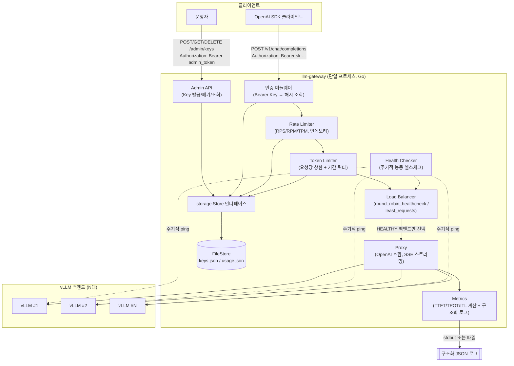
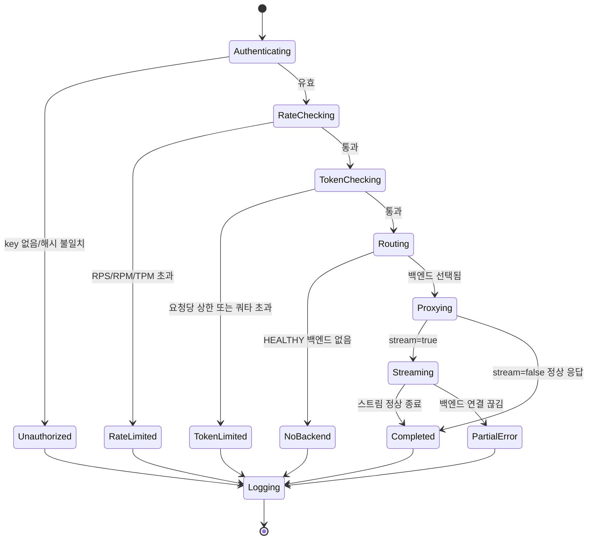
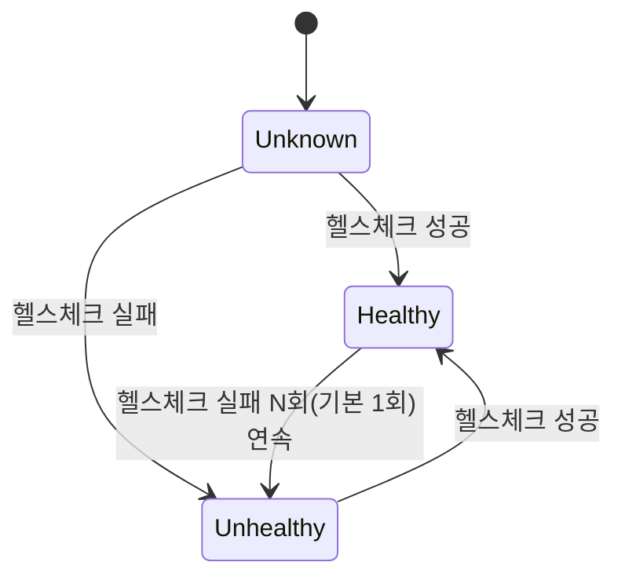
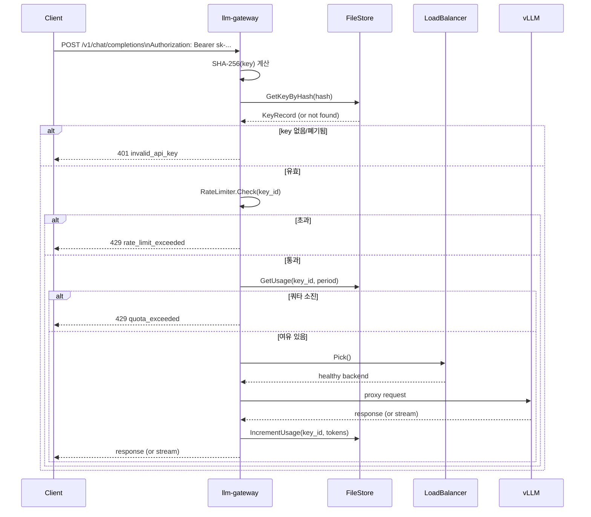

# Brief: llm-gateway (prd.md + sdd.md 병합본)

이 문서는 `/simple-e2e:prd-creator`로 작성한 `prd.md`와 `/simple-e2e:system-design`으로
작성한 `sdd.md`를 그대로 이어붙인 것입니다. `ask-harness`의 Planner는 아래 내용을
재설계하지 않고 그대로 `spec.md`에 반영해야 합니다 (아키텍처/API/데이터 모델/보안
설계는 이미 확정된 결정입니다).

---

## Part 1 — PRD (원본: prd.md)

### 1. 프로젝트 개요

| 항목 | 내용 |
|---|---|
| 서비스 이름 | llm-gateway |
| 한 줄 설명 | vLLM 추론 서버 앞단에서 인증(API Key)·요청 제어(Rate Limit/토큰 사용량 제한)·로드밸런싱·성능 관측(TTFT/TPOT/ITL)을 담당하는 Go 기반 LLM 게이트웨이 |
| 핵심 가치 | vLLM을 직접 노출하지 않고 **안전하게**(키 기반 접근 제어), **안정적으로**(과사용/폭주 방지), **확장 가능하게**(다중 vLLM 백엔드 로드밸런싱), **관측 가능하게**(요청별 지연시간 지표) 서비스한다 |
| 언어/런타임 | Go (최신 안정 버전) |

### 2. 타겟 유저 및 사용자 시나리오

- **타겟 유저**: 내부·외부 구분 없이, 발급된 API Key를 가진 모든 클라이언트(사람/서비스). 현재 범위에서는 테넌트/조직 단위 구분은 두지 않고 "Key 단위"로만 식별·제어한다.
- **운영자(관리자)**: 별도 관리자 토큰으로 Key를 발급·폐기·조회하고, 설정 파일로 rate limit/토큰 한도/백엔드 목록/로드밸런싱 전략을 관리한다.
- **핵심 시나리오**:
  1. 운영자가 관리자 API로 신규 클라이언트용 API Key를 발급한다.
  2. 클라이언트는 기존 OpenAI SDK/클라이언트를 그대로 사용해 `base_url`만 llm-gateway로 바꿔 `/v1/chat/completions` 등을 호출한다.
  3. Gateway는 인증 → Rate limit/토큰 한도 검사 → 로드밸런싱으로 vLLM 백엔드 선택 → 프록시 → 응답(스트리밍 포함) → TTFT/TPOT/ITL 로그 기록까지 처리한다.
  4. 백엔드가 여러 대면 자동 분산되고, 한 대만 있으면 그 backend로만 전달된다.
  5. 백엔드가 죽으면 헬스체크로 자동 감지해 라우팅 대상에서 제외한다.

### 3. 핵심 기능 명세

#### 필수 기능

1. **API Key 발급/폐기/조회** — 관리자 API(REST)로 처리. 관리자 API 자체는 설정 파일의 정적 관리자 토큰으로 인증.
2. **요청 인증** — 클라이언트 요청은 `Authorization: Bearer <key>` 헤더로 인증. Key는 상태 파일에 SHA-256 해시로 저장되며, 평문 Key는 발급 응답에서 단 한 번만 노출된다.
3. **Rate limit** — Key별로 요청 수(RPS/RPM)와 토큰 수(TPM)를 모두 제한. 설정 파일에서 Key/기본값 단위로 조정 가능.
4. **토큰 사용량 제한** — 두 가지를 모두 지원한다: (a) 요청당 `max_tokens` 상한치, (b) 기간(일/월 등)별 누적 토큰 할당량. 초과 시 요청을 거부한다.
5. **로드밸런싱** — 다중 vLLM 백엔드에 대해 "라운드로빈+헬스체크"와 "최소 연결/요청 기반" 두 전략을 모두 구현하고 설정 파일에서 전략을 선택할 수 있게 한다. 기본값은 라운드로빈+헬스체크. 백엔드가 1개뿐이면 해당 백엔드로만 라우팅된다.
6. **백엔드 헬스체크** — 설정된 주기(기본값 5초)마다 각 vLLM 백엔드에 능동적으로 헬스체크 요청을 보내 상태를 갱신하고, 불통 백엔드는 라우팅 대상에서 자동 제외한다.
7. **OpenAI 호환 프록시** — `/v1/chat/completions`, `/v1/completions` 등 vLLM이 이미 제공하는 OpenAI 호환 엔드포인트를 그대로 프록시한다. 스트리밍(SSE, `stream=true`) 필수 지원.
8. **토큰 카운팅** — vLLM 응답의 `usage` 필드(`prompt_tokens`/`completion_tokens`)를 신뢰하는 방식과 Gateway 자체 토크나이저로 계산하는 방식을 모두 구현하고 설정으로 선택 가능하게 한다. 기본값은 vLLM `usage` 필드 신뢰.
9. **성능 관측 로깅** — 요청당 TTFT(Time To First Token), TPOT(Time Per Output Token), ITL(Inter-Token Latency)을 측정해 로그로 남긴다. 사람이 읽기 쉬운 텍스트 로그와 구조화 JSON 로그(1요청 = 1줄)를 모두 지원하고 기본값은 구조화 JSON. 출력 대상은 stdout(기본)과 파일 중 설정으로 선택.
10. **파일 기반 상태 저장 + 스토리지 추상화** — 현재는 Key/사용량/설정 등 필요한 값을 JSON 파일로 읽고 쓴다. 다만 저장소는 Go 인터페이스(`Store`)로 추상화해, 향후 구현체만 교체하면 Redis나 RDB로 전환할 수 있도록 설계한다.

#### 향후 확장 (이번 범위 아님, Out of scope에서 재확인)

- Redis/RDB 스토리지 구현체
- 다중 Gateway 인스턴스 간 분산 상태 동기화(현재는 파일 기반이라 단일 인스턴스 가정)
- 조직/테넌트 단위 관리, 관리자 웹 UI
- Key 자기발급(셀프서비스) API

### 4. 기술 스택

| 영역 | 선택 | 근거 |
|---|---|---|
| 언어 | Go (최신 안정 버전) | 요청대로, 고성능 프록시/동시성 처리에 적합 |
| 웹 프레임워크 | Gin | 라우팅/미들웨어(인증, rate limit)가 간결하고 생태계가 큼 |
| 설정 파일 | YAML (`config.yaml`) | 사람이 직접 편집하는 설정에 적합 |
| 상태 파일 | JSON (`keys.json`, `usage.json` 등) | 기계가 쓰고 읽는 상태 데이터에 적합, 추후 Redis/RDB 마이그레이션 시 구조 매핑이 쉬움 |
| 스토리지 추상화 | `storage.Store` Go 인터페이스 + 파일 구현체(`FileStore`) | Redis/RDB 구현체로 교체 시 인터페이스만 만족하면 되도록 |
| 로깅 | 구조화 JSON(요청당 1줄) 기본, 텍스트 로그 옵션 | 관측성 도구와 바로 연동 가능하면서도 로컬에서 읽기도 쉽게 |
| 빌드 | Makefile — `make build OS=darwin ARCH=arm64` 등으로 darwin/linux × amd64/arm64 단일 바이너리 크로스 컴파일 | 외부 런타임 의존 없이 바이너리 하나로 배포 |
| 배포 | Dockerfile — `linux/amd64`, `linux/arm64` 멀티 아키텍처 이미지(buildx) | Mac(Apple Silicon 포함)과 Linux 호스트 모두에서 동일 이미지로 구동 |

### 5. 주요 API 흐름

#### 관리자 흐름 (Key 발급)

```
운영자 → POST /admin/keys (Authorization: Bearer <admin_token>)
       ← 201 { "key": "sk-...", "key_id": "...", "limits": {...} }   ← 평문 key는 이 응답에서만 노출
```

#### 클라이언트 요청 흐름

```
Client → POST /v1/chat/completions (Authorization: Bearer <api_key>, stream=true 가능)
           │
           ▼
      [인증 미들웨어] key 해시 조회, 유효성 확인
           │
           ▼
      [Rate limit 검사] RPS/RPM, TPM 한도 확인
           │
           ▼
      [토큰 한도 검사] 요청당 max_tokens 상한 + 기간별 누적 할당량 확인
           │
           ▼
      [로드밸런서] 헬스체크 통과한 백엔드 중 전략에 따라 1개 선택
           │
           ▼
      [프록시] 선택된 vLLM으로 요청 전달 (스트리밍이면 SSE 그대로 중계)
           │
           ▼
      [메트릭 수집] TTFT / TPOT / ITL 측정, 토큰 사용량 집계(usage 필드 or 자체 토크나이저)
           │
           ▼
      [로그 기록] stdout/파일에 구조화 JSON 1줄
           │
           ▼
      Client ← 응답(스트리밍 청크 또는 완성 응답)
```

#### 백엔드 헬스체크 흐름 (백그라운드)

```
매 health_check_interval(기본 5초)마다:
  각 vLLM 백엔드에 헬스체크 요청
    성공 → 라우팅 후보에 포함(복귀)
    실패 → 라우팅 후보에서 제외, 다음 주기에 재시도
```

### 6. 상세 기능 명세 및 예외 처리 정책

모든 에러 응답은 **OpenAI 에러 포맷**을 따른다: `{"error": {"message": "...", "type": "...", "code": "..."}}`.

| 상황 | HTTP 상태 | type/code 예시 | 비고 |
|---|---|---|---|
| API Key 누락/무효 | 401 | `invalid_api_key` | |
| Rate limit(RPS/RPM/TPM) 초과 | 429 | `rate_limit_exceeded` | `Retry-After` 헤더 포함 |
| 요청당 max_tokens 상한 초과 | 400 | `invalid_request_error` | 요청 자체가 잘못된 것으로 취급 |
| 기간별 토큰 할당량 소진 | 429 | `quota_exceeded` | |
| 모든 백엔드 헬스체크 실패(가용 백엔드 없음) | 503 | `no_available_backend` | |
| 관리자 API 인증 실패 | 401 | `invalid_admin_token` | |
| 설정/상태 파일 파싱 오류 | (기동 실패) | - | 프로세스는 기동하지 않고 명확한 원인을 stderr에 남긴다 |

- 백엔드로부터의 5xx 응답은 그대로 클라이언트에 전달하되, 로그에는 실패로 기록하고 다음 요청부터 헬스체크 결과에 따라 해당 백엔드를 회피할 수 있게 한다.
- 스트리밍 도중 백엔드 연결이 끊기면 이미 전송된 청크는 유지하고, 남은 스트림은 에러 이벤트로 종료한다(부분 응답+에러를 클라이언트가 구분할 수 있게).

### 7. 운영 가이드 (설정/로그 예시)

#### config.yaml 예시

```yaml
server:
  listen_addr: ":8080"

admin:
  token: "${ADMIN_TOKEN}"   # 환경변수 주입, 하드코딩 금지

backends:
  - url: "http://vllm-1:8000"
  - url: "http://vllm-2:8000"

load_balancer:
  strategy: "round_robin_healthcheck"   # round_robin_healthcheck | least_requests
  health_check_interval: "5s"

rate_limit:
  default:
    rpm: 60
    tpm: 100000

token_limit:
  default:
    max_tokens_per_request: 4096
    quota_period: "monthly"
    quota_tokens: 1000000

token_counting:
  method: "usage_field"   # usage_field | tokenizer

storage:
  keys_file: "./data/keys.json"
  usage_file: "./data/usage.json"

logging:
  format: "json"          # json | text
  output: "stdout"        # stdout | file
  file_path: "./logs/llm-gateway.log"
```

#### 로그 라인 예시 (구조화 JSON, 기본값)

```json
{"ts":"2026-09-08T10:00:00Z","request_id":"req_abc123","key_id":"key_001","model":"qwen2.5-7b","backend":"http://vllm-1:8000","stream":true,"ttft_ms":120,"tpot_ms":18.4,"itl_ms":[15,17,19,18],"prompt_tokens":42,"completion_tokens":256,"status":200}
```

#### 관리자 API 예시

```bash
# Key 발급
curl -X POST http://gateway:8080/admin/keys \
  -H "Authorization: Bearer $ADMIN_TOKEN" \
  -d '{"name":"team-a","rpm":60,"tpm":100000}'

# Key 폐기
curl -X DELETE http://gateway:8080/admin/keys/key_001 \
  -H "Authorization: Bearer $ADMIN_TOKEN"
```

### 8. 제약사항 및 보안 요구사항

- **단일 인스턴스 가정**: 상태(Key/사용량)를 로컬 JSON 파일로 관리하므로, 현재 설계는 Gateway를 단일 인스턴스로 운영하는 것을 전제로 한다. 여러 인스턴스를 동시에 띄우면 rate limit/토큰 사용량 카운트가 인스턴스별로 분리되어 정합성이 깨진다. 다중 인스턴스 수평 확장은 `storage.Store`를 Redis/RDB 구현체로 교체한 이후의 범위다.
- **스토리지 교체 용이성**: `storage.Store` 인터페이스(Key 조회/생성/폐기, 사용량 증가/조회 등)를 정의하고 `FileStore`가 이를 구현한다. Redis/RDB 전환 시 이 인터페이스를 만족하는 새 구현체만 추가하면 상위 로직(인증/rate limit/토큰 한도) 변경이 없어야 한다.
- **비밀값 관리**: 관리자 토큰은 설정 파일에 직접 쓰지 않고 환경변수(`${ADMIN_TOKEN}` 형태로 YAML에서 참조)로 주입한다. 소스코드에 어떤 비밀값도 하드코딩하지 않는다.
- **API Key 저장**: 평문 저장 금지. SHA-256 해시로 저장하고, 평문은 발급 응답에서 1회만 노출한다.
- **로그의 민감정보**: 로그에 API Key 평문이나 프롬프트/응답 본문 전체를 남기지 않는다 (메트릭/메타데이터만 기록).
- **TLS**: Gateway 자체는 HTTP로 동작하고, TLS 종료는 앞단 리버스 프록시/로드밸런서에서 처리하는 것을 전제로 한다(현재 범위 밖).
- **SQL 관련 규칙**: 현재 범위(파일 저장)에는 해당 없음. 향후 RDB 구현체 추가 시 파라미터 바인딩을 강제한다.
- **오픈소스 라이선스**: 사용하는 Go 모듈(Gin 등)은 MIT/Apache 2.0 등 허용 라이선스만 사용하고, `go.mod`에 의존성과 버전을 명시한다.

### 9. Out of scope (명시적으로 이번 범위에서 제외)

- Redis/RDB 스토리지 구현체 (인터페이스만 준비, 구현은 후속)
- 다중 Gateway 인스턴스 간 분산 상태 동기화
- 조직/테넌트 단위 쿼타, 멀티테넌시
- 관리자 웹 UI (관리자 REST API만 제공)
- Key 자기발급(셀프서비스) API
- Gateway 자체 TLS 종료
- vLLM 외 다른 추론 서버(TGI 등) 지원

---

## Part 2 — 시스템 설계서 (원본: sdd.md)

### 1. 프로젝트 개요

| 항목 | 내용 |
|---|---|
| 프로젝트명 | llm-gateway |
| 한 줄 설명 | vLLM 추론 서버 앞단에서 인증(API Key)·요청 제어(Rate Limit/토큰 사용량 제한)·로드밸런싱·성능 관측(TTFT/TPOT/ITL)을 담당하는 Go 기반 LLM 게이트웨이 |
| 기술 스택 | Go + Gin, YAML(설정)/JSON(상태), 파일 기반 스토리지(Store 인터페이스로 추상화, 향후 Redis/RDB 교체) |
| 작성일 | 2026-09-08 |
| 기반 문서 | prd.md |

### 2. 전체 시스템 아키텍처



- 현재 설계는 **단일 프로세스, 단일 인스턴스**를 전제로 한다(파일 기반 상태 저장이므로). 수평 확장은 `storage.Store`를 Redis/RDB 구현체로 교체한 이후의 범위다(prd.md §8, §9).
- 백엔드가 1대뿐이면 Load Balancer는 항상 그 1대만 반환한다(별도 분기 불필요 — "가용 백엔드 목록 중 전략에 따라 1개 선택"이라는 동일 로직이 자연히 그렇게 동작한다).

### 3. 데이터 모델링 (파일 기반 — DB 대신 구조체/인터페이스 명세)

DB를 사용하지 않으므로, ERD 대신 **저장소 인터페이스와 파일 스키마**를 명세한다. 이 인터페이스가 Redis/RDB 마이그레이션의 안정된 경계선이다.

#### 3.1 storage.Store 인터페이스

```go
package storage

type Store interface {
    // Key 관리
    CreateKey(ctx context.Context, rec KeyRecord) error
    GetKeyByHash(ctx context.Context, keyHash string) (KeyRecord, bool, error)
    RevokeKey(ctx context.Context, keyID string) error
    ListKeys(ctx context.Context) ([]KeyRecord, error)

    // 사용량 관리 (기간별 누적 토큰 쿼타 — RPS/RPM/TPM은 인메모리에서 별도 처리, §6 참고)
    GetUsage(ctx context.Context, keyID string, period string) (UsageRecord, error)
    IncrementUsage(ctx context.Context, keyID string, period string, tokens int64) error
    ResetUsage(ctx context.Context, keyID string, period string) error
}
```

- `FileStore`가 이 인터페이스의 최초 구현체(JSON 파일 기반).
- 향후 `RedisStore`/`SQLStore`가 동일 인터페이스를 구현하면 `internal/admin`, `internal/auth`, `internal/tokenlimit` 등 상위 로직은 **한 줄도 수정하지 않는다** — `main.go`의 조립(wiring) 지점만 바뀐다.

#### 3.2 KeyRecord (keys.json)

| 필드 | 타입 | 제약조건 | 설명 |
|---|---|---|---|
| key_id | string | PK, 고유 | 사람이 참조하는 식별자 (`key_xxxxxxxx`) |
| key_hash | string | 고유, not null | API Key의 SHA-256 해시(hex). 평문은 저장하지 않음 |
| name | string | not null | 발급 대상 라벨(예: `team-a`) |
| created_at | RFC3339 string | not null | 발급 시각 |
| revoked_at | RFC3339 string \| null | nullable | 폐기 시각. null이면 활성(soft delete 방식 — 이력 보존을 위해 레코드 자체는 삭제하지 않음) |
| limits.rpm | int | ≥ 0 | 분당 요청 수 상한 |
| limits.tpm | int | ≥ 0 | 분당 토큰 수 상한 |
| limits.max_tokens_per_request | int | ≥ 0 | 요청당 `max_tokens` 상한 |
| limits.quota_period | string | `daily`\|`monthly` | 누적 토큰 쿼타 주기 |
| limits.quota_tokens | int64 | ≥ 0 | 주기당 누적 토큰 상한 |

```json
// data/keys.json — 파일 전체는 KeyRecord 배열
[
  {
    "key_id": "key_9f1c2a",
    "key_hash": "b94d27b9934d3e08a52e52d7da7dabfa...",
    "name": "team-a",
    "created_at": "2026-09-08T09:00:00Z",
    "revoked_at": null,
    "limits": { "rpm": 60, "tpm": 100000, "max_tokens_per_request": 4096,
                "quota_period": "monthly", "quota_tokens": 1000000 }
  }
]
```

#### 3.3 UsageRecord (usage.json)

| 필드 | 타입 | 설명 |
|---|---|---|
| key_id | string | FK → KeyRecord.key_id |
| period | string | 쿼타 주기 식별자 (예: `2026-09` 월간, `2026-09-08` 일간) |
| tokens_used | int64 | 해당 기간 누적 사용 토큰(prompt+completion) |
| updated_at | RFC3339 string | 마지막 갱신 시각 |

```json
// data/usage.json — key_id → period → UsageRecord
{
  "key_9f1c2a": {
    "2026-09": { "tokens_used": 152340, "updated_at": "2026-09-08T10:00:00Z" }
  }
}
```

- 파일이 없으면 최초 기동 시 빈 구조(`[]`, `{}`)로 자동 생성한다(DB 자동 초기화 규칙의 파일 스토리지 버전).
- 파일 권한은 `0600`으로 생성한다(민감 정보인 key_hash 포함).
- RPS/RPM/TPM 카운터는 이 파일에 넣지 않는다 — 초 단위로 갱신되는 값을 매번 디스크에 쓰면 I/O 병목이 되므로 인메모리로만 관리한다(§6 참고). 파일에는 "재시작해도 보존해야 하는" 누적 토큰 쿼타만 둔다.

### 4. 핵심 API 인터페이스 명세

공통: 모든 응답은 `Content-Type: application/json`. 모든 에러는 OpenAI 호환 포맷을 따른다(§8).

#### 4.1 관리자 API

##### POST /admin/keys
**설명**: API Key 발급
**인증**: `Authorization: Bearer <admin_token>` 필수
**Request Body**:
```json
{
  "name": "string (required, 1-100자)",
  "rpm": "int (optional, 기본값은 설정파일 default)",
  "tpm": "int (optional)",
  "max_tokens_per_request": "int (optional)",
  "quota_period": "string (optional, daily|monthly)",
  "quota_tokens": "int64 (optional)"
}
```
**Response 201**:
```json
{
  "key_id": "key_9f1c2a",
  "key": "sk-live-...",
  "name": "team-a",
  "created_at": "2026-09-08T09:00:00Z",
  "limits": { "rpm": 60, "tpm": 100000, "max_tokens_per_request": 4096,
              "quota_period": "monthly", "quota_tokens": 1000000 }
}
```
> `key` 평문은 **이 응답에서만** 노출된다. 이후에는 `key_hash`만 저장/조회된다.

**에러 응답**:
| 코드 | type/code | 설명 |
|---|---|---|
| 401 | invalid_admin_token | 관리자 토큰 누락/불일치 |
| 400 | invalid_request_error | `name` 누락 등 |

##### GET /admin/keys
**설명**: 발급된 Key 목록 조회 (key_hash/평문 제외, 메타데이터만)
**인증**: 관리자 토큰 필수
**Response 200**: `KeyRecord`(평문/해시 제외) 배열

##### DELETE /admin/keys/{key_id}
**설명**: Key 폐기(soft delete — `revoked_at` 설정, 레코드는 보존)
**인증**: 관리자 토큰 필수
**Response 200**: `{ "key_id": "key_9f1c2a", "revoked_at": "2026-09-08T11:00:00Z" }`
**에러**: 404 `key_not_found` (존재하지 않는 key_id)

#### 4.2 프록시 API (OpenAI 호환)

##### POST /v1/chat/completions
##### POST /v1/completions
**설명**: vLLM의 OpenAI 호환 엔드포인트로 그대로 프록시. Request/Response 스키마는 vLLM(OpenAI) 사양을 그대로 따르며 Gateway가 필드를 가공하지 않는다.
**인증**: `Authorization: Bearer <api_key>` 필수
**Request Body**: vLLM/OpenAI Chat Completions 스키마 (`model`, `messages`, `max_tokens`, `stream` 등)
**Response 200 (비스트리밍)**: vLLM 원본 JSON 응답을 그대로 전달
**Response 200 (스트리밍, `stream=true`)**: `Content-Type: text/event-stream`, vLLM이 보내는 SSE 청크를 그대로 중계. 청크 도착마다 ITL 계산에 사용.
**에러 응답**: §8 표 참고 (401/429/400/503)

#### 4.3 운영(Ops) 엔드포인트 — PRD에 없는 DevOps 관점 추가

##### GET /healthz
**설명**: Gateway 프로세스 자체의 liveness (vLLM 백엔드 상태와 무관 — 컨테이너 오케스트레이터의 헬스체크용)
**인증**: 불필요
**Response 200**: `{ "status": "ok" }`

##### GET /readyz
**설명**: readiness — 가용한(HEALTHY) vLLM 백엔드가 1개 이상 있는지 여부
**인증**: 불필요
**Response 200**: `{ "status": "ready", "healthy_backends": 2, "total_backends": 3 }`
**Response 503**: 가용 백엔드가 0개일 때

### 5. 폴더 구조 및 컴포넌트 분리 전략

```
llm-gateway/
├── cmd/
│   └── llm-gateway/
│       └── main.go              # 설정 로드 → Store/컴포넌트 조립(wiring) → Gin 라우터 기동
├── internal/
│   ├── config/                  # config.yaml 파싱, ${VAR} 환경변수 치환, 검증
│   ├── admin/                   # 관리자 API 핸들러 (키 발급/조회/폐기)
│   ├── auth/                    # Bearer 토큰 인증 미들웨어 (client key, admin token 공용 로직)
│   ├── ratelimit/               # RPS/RPM/TPM 인메모리 리미터 (슬라이딩 윈도우/토큰버킷)
│   ├── tokenlimit/               # 요청당 상한 검사 + 기간별 누적 쿼타 검사(Store 연동)
│   ├── loadbalancer/             # Strategy 인터페이스: RoundRobinHealthcheck, LeastRequests
│   ├── healthcheck/               # 백엔드 주기적 능동 헬스체크, 상태 브로드캐스트
│   ├── proxy/                     # OpenAI 호환 프록시(비스트리밍/SSE 스트리밍) 핸들러
│   ├── tokencount/                 # UsageField / Tokenizer 두 가지 카운팅 전략
│   ├── metrics/                     # TTFT/TPOT/ITL 계산, 구조화 JSON·텍스트 로거
│   ├── storage/                      # Store 인터페이스 + FileStore 구현체 + 모델(KeyRecord 등)
│   └── apierror/                      # OpenAI 호환 에러 응답 생성 헬퍼
├── config.yaml.example            # 커밋되는 예시 설정 (실 설정은 .gitignore)
├── data/                           # keys.json, usage.json (.gitignore, 0600)
├── logs/                            # 파일 로그 출력 시 (.gitignore)
├── Makefile                          # build/test/docker 타겟, OS/ARCH 크로스 컴파일
├── Dockerfile                         # multi-stage, linux/amd64+arm64 buildx
├── go.mod / go.sum
└── README.md
```

- **도메인 기반 분리**: `internal/`은 계층(controller/service/model)이 아니라 관심사 도메인(auth, ratelimit, loadbalancer, proxy…) 단위로 나눈다 — 각 도메인이 독립적으로 테스트 가능해야 하며, Redis/RDB 전환 시 `storage/`만 영향을 받는다.
- `internal/`로 감싸 외부 모듈에서 import 불가능하게 해 공개 API 표면을 `cmd/`와 (필요시) `pkg/`로 제한한다.

### 6. 내부 상태 흐름 (상태 관리 — 프론트엔드 없는 백엔드이므로 상태 머신/데이터 흐름으로 대체)

#### 6.1 요청 처리 파이프라인 (상태 전이)



#### 6.2 백엔드 헬스 상태 머신 (Health Checker가 소유)



- Load Balancer는 항상 `Healthy` 상태의 백엔드 집합에서만 선택한다. `Unknown`(최초 기동 직후 아직 1회도 체크 안 됨)은 라우팅 후보에서 제외해 콜드스타트 시 미검증 백엔드로 트래픽이 가지 않게 한다.

#### 6.3 인메모리 vs 파일 상태 구분

| 상태 | 저장 위치 | 이유 |
|---|---|---|
| RPS/RPM/TPM 카운터 | 인메모리 (mutex/atomic 보호) | 초 단위 갱신, 재시작 시 리셋되어도 무해(짧은 윈도우) — 파일 I/O 부담 회피 |
| 백엔드 헬스 상태 | 인메모리 | 재시작 시 즉시 재검증되므로 영속 불필요 |
| Key 메타데이터/해시 | 파일(keys.json), 인메모리 캐시로 조회 가속 | 재시작 후에도 발급된 Key가 유지되어야 함 |
| 기간별 누적 토큰 쿼타 | 인메모리 캐시 + 파일(usage.json)에 주기적 flush(기본 5초) 및 정상 종료 시 flush | 재시작 후에도 쿼타 소진량이 유지되어야 하지만, 매 요청마다 디스크에 쓰면 지연시간에 영향 → write-behind로 절충. **주의**: 비정상 종료(kill -9, 크래시) 시 마지막 flush 이후 수 초 분량의 사용량 카운트가 유실될 수 있음 — Redis/RDB 전환 전까지 감수하는 트레이드오프로 prd.md §8에 이미 문서화된 "단일 인스턴스/파일 기반" 제약의 연장선이다. |

### 7. 보안 설계

#### 7.1 위협 대응 매트릭스 (OWASP 기반, 이 프로젝트에 적용 가능한 항목만)

| 위협 | 대응 방안 | 구현 위치 |
|---|---|---|
| A01 Broken Access Control | 클라이언트 API Key와 관리자 토큰의 권한을 완전히 분리(관리자 토큰으로만 `/admin/*` 접근). Key 조회는 해시 비교만 수행 | `internal/auth` |
| A02 Cryptographic Failures | API Key는 SHA-256 해시로 저장, 평문은 발급 응답에서 1회만 노출 후 폐기 불가능(재발급만 가능) | `internal/storage`, `internal/admin` |
| A05 Security Misconfiguration | `admin.token`이 비어있으면 **기동 자체를 거부**(fail-fast)하고 원인을 stderr에 남긴다. 기본 CORS는 비허용(필요 시 명시적 화이트리스트) | `internal/config`, `cmd/llm-gateway/main.go` |
| A07 Identification & Auth Failures | 해시 비교는 상수시간 비교(`crypto/subtle.ConstantTimeCompare`)로 타이밍 공격 방지 | `internal/auth` |
| A08 Software & Data Integrity | `go.mod`에 의존성 버전 고정, MIT/Apache-2.0 라이선스만 허용(§7.4) | 빌드 파이프라인 |
| A09 Security Logging & Monitoring Failures | 요청마다 `request_id`를 부여해 구조화 로그에 남기고, 인증 실패/레이트리밋 초과도 별도 로그 이벤트로 기록 | `internal/metrics` |
| SSRF (백엔드 목록 변조) | vLLM 백엔드 URL은 오직 `config.yaml`에서만 정의되며 요청 파라미터로 대상 백엔드를 바꿀 수 있는 경로가 없음 | `internal/loadbalancer` |

#### 7.2 인증/인가 흐름도



#### 7.3 민감 데이터 처리 정책

- 로그에는 API Key 평문, `Authorization` 헤더 원문, 프롬프트/응답 본문 전체를 **남기지 않는다**. 로그에는 `key_id`(해시가 아닌, 발급 시 부여된 비민감 식별자)만 남긴다.
- 상태 파일(`data/*.json`)은 파일 권한 `0600`으로 생성, `.gitignore`에 포함. 커밋되는 것은 `config.yaml.example`뿐이다.
- 관리자 토큰은 `config.yaml`에 직접 쓰지 않고 `${ADMIN_TOKEN}` 형태로 참조해 프로세스 환경변수에서 주입한다(.env 파일은 사용하지 않음 — 컨테이너/오케스트레이터의 시크릿 주입 메커니즘을 그대로 활용).

#### 7.4 환경변수 및 설정 관리

- 설정 파일은 YAML만 사용한다(`.env` 형식 금지). 비밀값만 `${VAR_NAME}` 문법으로 프로세스 환경변수를 참조한다.
- 설정 파일 경로는 `--config` 플래그(기본값 `./config.yaml`) 또는 `LLM_GATEWAY_CONFIG` 환경변수로 지정 가능해야 한다. 우선순위: **CLI 플래그 > 환경변수(`LLM_GATEWAY_CONFIG`) > 기본값**.
- 설정 파일 내 `${VAR}` 미해결(환경변수 없음) 시 해당 값이 필수 필드(예: `admin.token`)라면 기동을 거부한다.

#### 7.5 의존성 라이선스 검토

| 패키지 | 용도 | 라이선스 |
|---|---|---|
| github.com/gin-gonic/gin | HTTP 라우팅/미들웨어 | MIT |
| gopkg.in/yaml.v3 | YAML 파싱 | MIT/Apache-2.0 (dual) |
| (표준 라이브러리 `crypto/sha256`, `encoding/json` 등) | 해시/직렬화 | BSD-style (Go 표준) |

GPL 계열 의존성은 사용하지 않는다. 신규 의존성 추가 시 이 표를 갱신한다.

### 8. 예외 처리 및 에러 전략

#### 8.1 에러 응답 포맷

prd.md에서 **OpenAI 호환 포맷**을 채택했으므로(기존 OpenAI 클라이언트 라이브러리와의 호환이 이 프로젝트의 핵심 가치), RFC 7807 대신 OpenAI 에러 스키마로 통일한다:

```json
{ "error": { "message": "string", "type": "string", "code": "string" } }
```

| 상황 | HTTP | type | code |
|---|---|---|---|
| API Key 누락/무효/폐기됨 | 401 | authentication_error | invalid_api_key |
| RPS/RPM/TPM 초과 | 429 | rate_limit_error | rate_limit_exceeded |
| 요청당 `max_tokens` 상한 초과 | 400 | invalid_request_error | max_tokens_exceeded |
| 기간별 누적 토큰 쿼타 소진 | 429 | rate_limit_error | quota_exceeded |
| 가용 백엔드 없음 | 503 | api_error | no_available_backend |
| 관리자 토큰 누락/불일치 | 401 | authentication_error | invalid_admin_token |
| 존재하지 않는 key_id 폐기 시도 | 404 | invalid_request_error | key_not_found |

- 429 응답에는 `Retry-After` 헤더를 포함한다(윈도우 리셋까지 남은 초 단위).
- vLLM이 HTML/빈 응답 등 비정상 응답을 반환하면 그대로 클라이언트에 전달하지 않고 위 `no_available_backend` 또는 502 `bad_gateway`(신규 code)로 감싸 OpenAI 포맷으로 통일한다.

#### 8.2 에러 분류

- **비즈니스 에러** (4xx): 인증 실패, rate limit/쿼타 초과, 잘못된 요청 — 클라이언트가 재시도 방식을 바꿔야 하는 것들.
- **시스템 에러** (5xx): 백엔드 전원 다운, 예기치 못한 패닉 — Gin의 `Recover` 미들웨어로 패닉을 잡아 500으로 변환하고 스택은 로그에만 남긴다(클라이언트에는 노출 안 함).

#### 8.3 로깅 전략

- 모든 요청은 `internal/metrics`를 거쳐 요청당 1줄 로그를 남긴다(성공/실패 모두). 레벨은 `info`(성공), `warn`(4xx), `error`(5xx/패닉)로 구분.
- 민감정보(Authorization 헤더, 프롬프트/응답 본문)는 마스킹하고 남기지 않는다(§7.3).

#### 8.4 재시도 정책

- Gateway는 vLLM 응답에 대해 **자동 재시도를 하지 않는다** (v1 범위). 근거: 스트리밍 응답은 이미 클라이언트로 부분 전송이 시작됐을 수 있어 재시도가 중복 응답을 유발할 수 있고, LLM 추론 요청은 멱등성이 보장되지 않는다(모델 출력이 매번 달라질 수 있음).
- 대신 헬스체크가 장애 백엔드를 빠르게(기본 5초 주기) 라우팅 후보에서 제외해, **다음 요청**이 자동으로 건강한 백엔드로 가도록 한다.

### 9. 3줄 요약 및 비유

> **3줄 요약**
> 1. 클라이언트는 llm-gateway를 마치 OpenAI 서버처럼 그대로 호출하고, Gateway가 뒤에서 Key 검증·사용량 제한·여러 vLLM 서버 중 하나로의 분배를 대신 처리합니다.
> 2. 누가 얼마나 썼는지는 지금은 파일에 기록하지만, 나중에 Redis나 데이터베이스로 바꿔도 다른 코드는 건드리지 않도록 창구(인터페이스)를 하나로 정해뒀습니다.
> 3. 모든 요청은 얼마나 빨리 첫 글자가 나왔고(TTFT) 얼마나 매끄럽게 이어졌는지(TPOT/ITL)를 기록으로 남겨, 나중에 성능을 눈으로 확인할 수 있습니다.
>
> **비유로 이해하기**
> llm-gateway는 **여러 창구가 있는 은행의 안내 데스크**와 비슷합니다. 손님(클라이언트)이 신분증(API Key) 대신 미리 발급받은 번호표(Bearer Key)를 보여주면, 안내 데스크(Gateway)가 번호표가 진짜인지, 오늘 이 손님이 창구를 너무 자주 쓰지는 않았는지(Rate limit), 하루 이용 한도를 넘지 않았는지(토큰 쿼타)를 확인합니다. 통과하면 지금 한가한 창구(vLLM 서버)로 안내하고, 그 창구가 닫혀 있으면(장애) 자동으로 다른 창구로 보냅니다. 손님이 처리되는 동안 안내 데스크는 대기 시간과 처리 속도를 계속 기록해 나중에 "어느 창구가 얼마나 빠른지" 보고서를 만들 수 있게 합니다. 지금은 이 모든 기록을 종이 장부(파일)에 적지만, 나중에 손님이 많아지면 전산 시스템(Redis/RDB)으로 바꿀 수 있도록 장부 양식을 미리 표준화해뒀습니다.
